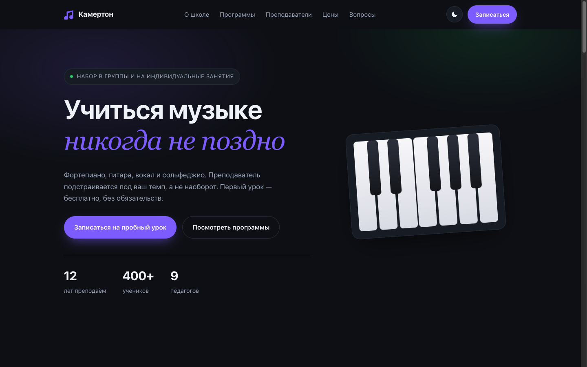
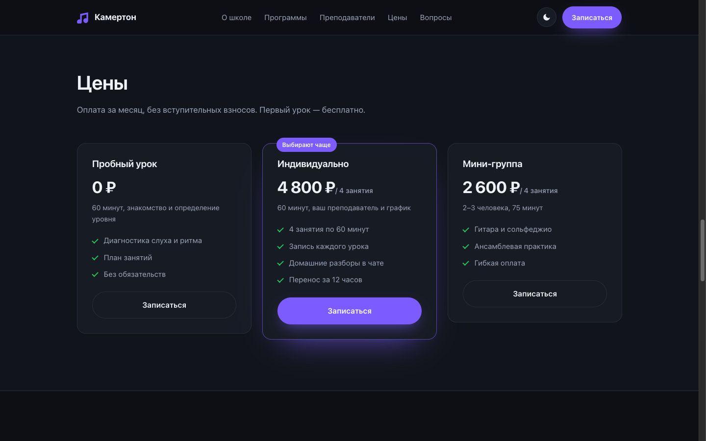
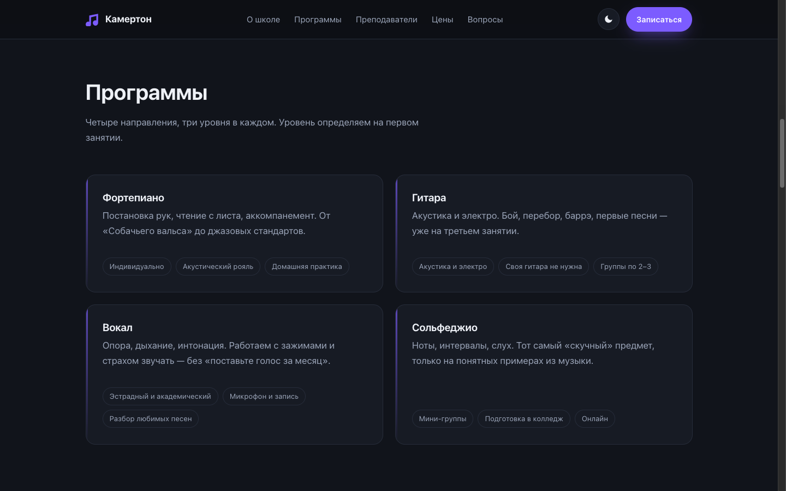
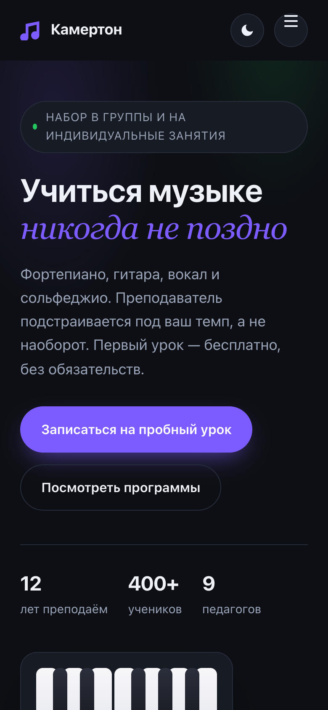

# Камертон — лендинг школы музыки

Дизайн-концепт и полностью рабочий адаптивный лендинг школы музыки: тёмная и светлая темы, анимации появления блоков, валидация формы записи с маской телефона. Без фреймворков, шрифтов с CDN и прочих внешних зависимостей — чистые HTML, CSS и ES2020.

**Демо:** https://irinatunes.github.io/music-school-landing/

| Десктоп | Цены |
|---|---|
|  |  |

| Программы | Мобильный |
|---|---|
|  |  |

## Что реализовано

- **Тёмная тема по умолчанию + переключение на светлую** с сохранением в `localStorage` и обновлением `meta[theme-color]`.
- **Адаптив**: 3 контрольные точки (980 / 900 / 720 px), бургер-меню с `aria-expanded`, отсутствие горизонтального скролла на 320–1440 px.
- **Анимации появления** на `IntersectionObserver` + страховка по таймеру и полное отключение при `prefers-reduced-motion`.
- **Форма записи**: проверка имени и телефона, маска `+7 (999) 123-45-67`, обязательное согласие на обработку данных, сообщение об успехе, `aria-invalid` и текст ошибок под полями.
- **Аккордеон FAQ** с автоматическим закрытием соседних пунктов, `details/summary` без JS-зависимости.
- **Доступность**: skip-link, фокус-стили, семантические заголовки, `aria-live` для статуса формы.
- **Проверка в CI**: workflow валидирует наличие обязательных элементов и ассетов перед публикацией.

## Чего нет (честно)

- Бэкенда: заявка сохраняется в `localStorage`, реальной отправки на сервер нет. Для продакшена — `fetch('/api/signup')`.
- Реальных отзывов и преподавателей: контент демонстрационный.
- Политика cookie/аналитика не подключены.

## Локальный запуск

```bash
python3 -m http.server 8123
# открыть http://localhost:8123/
```

## Структура

```
index.html               разметка страницы
assets/styles.css        дизайн-система: токены, компоненты, адаптив
assets/app.js            тема, меню, анимации, валидация формы
assets/favicon.svg       иконка
assets/screenshots/      скриншоты для этого README
.github/workflows/pages.yml  проверка + деплой на GitHub Pages
```

## Проверено

- Нет JS-ошибок в консоли на всех проверенных разрешениях.
- Валидация: пустая форма → 3 ошибки; неверные данные → ошибки; корректные → сообщение об успехе и запись заявки.
- Маска телефона: `9161234567` → `+7 (916) 123-45-67`.
- Горизонтальный скролл отсутствует на 390 и 1440 px.
